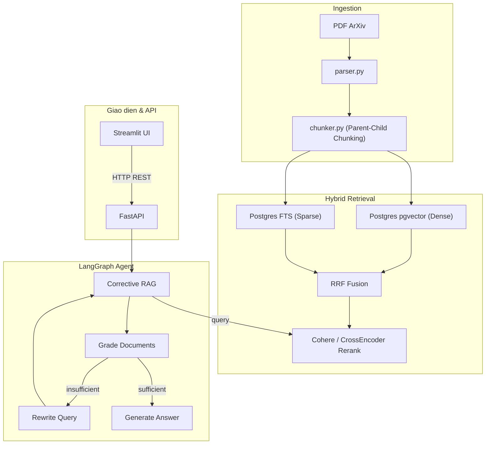

# ArXiv Agentic RAG

Corrective-RAG (CRAG) question-answering system over scientific PDF papers. Upload a paper, ask questions about it in Vietnamese or English, get answers grounded in the paper's content with source citations.



## Status

Mid-upgrade from MVP to a production-grade portfolio project. Phase 1 (hardening) and Phase 2 (Supabase Postgres + pgvector, Gemini embeddings, Postgres FTS, Postgres-backed chat memory) are done. Planned next: eval harness (Recall@k, nDCG), multi-paper querying, RAPTOR, production polish (auth, rate limiting, streaming).

## Stack

- **Parsing**: PyMuPDF4LLM (with raw `fitz` fallback)
- **Chunking**: section-based parent-child (regex heading detection + sliding window)
- **Retrieval**: Postgres/pgvector (dense) + Postgres full-text search (sparse) → Reciprocal Rank Fusion → Cohere Rerank / local CrossEncoder fallback
- **Agent**: LangGraph Corrective-RAG (`retrieve → grade → rewrite-if-insufficient → generate`)
- **LLM**: Groq (primary) with automatic runtime fallback to Gemini
- **Backend**: FastAPI
- **Frontend**: Streamlit
- **Deploy**: Vercel (API) + Streamlit Community Cloud (UI)

## Setup

```bash
pip install -r requirements.txt
cp .env.example .env   # fill in GROQ_API_KEY, GEMINI_API_KEY, COHERE_API_KEY, HF_TOKEN
```

## Running

```bash
# API (from repo root, auto-reloads)
uvicorn app.api.main:app --reload --port 8000
# Swagger UI: http://localhost:8000/docs

# UI (separate process, calls the API over HTTP)
streamlit run streamlit_app.py
```

Or with the Makefile: `make run`, `make ui`.

## Deploy

**API on Vercel (Hobby plan)** - the FastAPI app is deployed as a single Python function.

1. Import the GitHub repo in Vercel. No framework preset or build command needed: `pyproject.toml` (`[tool.vercel] entrypoint`) and `vercel.json` (300 s `maxDuration`, `excludeFiles`, cron) already configure everything. `.python-version` pins Python 3.12 and Vercel installs `requirements.txt` (the slim runtime set, no torch).
2. Set these environment variables (Project -> Settings -> Environment Variables):
   - `DATABASE_URL` - Supabase Session pooler URI
   - `GEMINI_API_KEY` (embeddings + LLM), optionally `GROQ_API_KEY`
   - `COHERE_API_KEY` - strongly recommended: without it (and without `sentence-transformers`, which is not installed on Vercel) reranking is disabled and chunks keep their RRF order
   - `APP_API_KEY` - when set, every `/api/v1` route except `/health` and `/health/db` requires header `X-API-Key: <value>`
   - `ALLOWED_ORIGINS` - comma-separated; add the Streamlit Cloud URL (e.g. `https://your-app.streamlit.app`)
   - optional: `GEMINI_MODEL_NAME`, `MAX_UPLOAD_MB`
3. The cron in `vercel.json` calls `GET /api/v1/health/db` once a day so Supabase free does not auto-pause after 7 idle days (cron runs on production deployments only).

Limits to know about:
- A request is cut off after 300 s (`maxDuration`); a paper whose indexing is killed stays `processing` and is reported as `failed` by `GET /api/v1/papers/{id}/status` after 15 minutes.
- Request bodies are capped at 4.5 MB by Vercel, so `POST /api/v1/upload` rejects files over 4 MB (`MAX_UPLOAD_MB`, HTTP 413). For arXiv papers use `POST /api/v1/papers/arxiv` with `{"arxiv_id": "2401.15884"}`: the server downloads the PDF itself.
- The filesystem is read-only except `/tmp` (data and caches go to `/tmp`, which does not survive across instances); papers live in Postgres, not on disk.
- Gemini free tier allows 100 embeddings/min and 1000/day; indexing jobs are serialized per process to stay inside it.

**UI on Streamlit Community Cloud** - create an app from this repo pointing at the Streamlit entry file under `ui/`, and set the secret `API_BASE` to the Vercel URL (if `APP_API_KEY` is set, the UI must send it as `X-API-Key`; see the `ui/` docs for the secret name).

For local development install `requirements-dev.txt` (adds `sentence-transformers` for the local CrossEncoder fallback, `pytest`, `ruff`).

## Docker

```bash
docker build -t arxiv-rag .
docker run -p 8000:8000 --env-file .env arxiv-rag
```

## Testing & linting

```bash
make test   # pytest tests/
make lint   # ruff check .
```

CI (`.github/workflows/ci.yml`) runs both on every push/PR to `main`.

## Project layout

- `app/ingestion/` — PDF parsing (`parser.py`) and parent-child chunking (`chunker.py`)
- `app/indexing/` — embedding provider (`embeddings.py`) and reranking (`reranker.py`)
- `app/storage/` — Postgres repository layer (`repository.py`): CRUD for papers/sections/chunks + `hybrid_search()` (dense pgvector + sparse Postgres FTS, fused with RRF)
- `app/agent/` — LangGraph Corrective-RAG agent (`rag_graph.py`)
- `app/llm/` — LLM provider factory (`llm_factory.py`) and prompt templates (`prompt_templates.py`)
- `app/api/` — FastAPI app and routes
- `streamlit_app.py` — frontend
